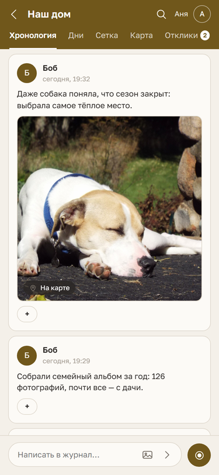
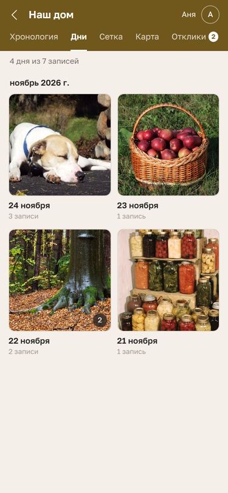
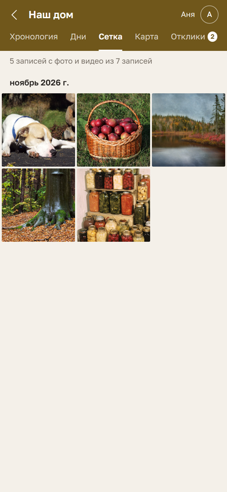
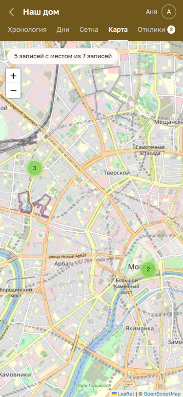
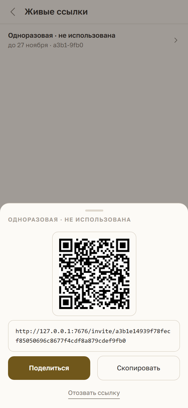

# Wynd

**Закрытый журнал для своих.** Круг — это закрытая группа со своим журналом: семья, друзья, коллеги. В круг попадают по ссылке от того, кто уже в нём. Сервер ставит один человек, остальные открывают приложение в браузере телефона.

Это не облачный сервис и не социальная сеть: нет общей ленты, подписчиков, рекомендаций и рекламы. Есть журнал, который живёт на сервере человека, которого вы знаете.

## Что такое Wynd

- **Круг — закрытая группа.** У каждого круга свой журнал, своё имя и своя видимость. Один человек может быть в нескольких кругах и в каждом выглядеть по-своему.
- **В круг зовут по ссылке.** Приглашение — ссылка или QR-код от того, кто уже в круге. Случайных людей и общей ленты нет.
- **Один человек ставит сервер.** Обычно это кто-то из семьи или друзей. Остальные просто открывают адрес, входят по коду из письма и ставят приложение на экран телефона.
- **Каждый круг живёт отдельно.** Серверы не знают друг о друге; данные круга не уходят в общую сеть.

## Как устроен журнал

Записи собраны по дням, а не в бесконечную ленту. В круге можно писать, отвечать, ставить отклики и прикладывать фото, видео, голосовые и файлы.

- **Хронология** — записи и обсуждения в том порядке, в каком они появились.
- **Дни** — журнал по дням: у дня может быть название и обложка.
- **Сетка** — все фотографии и видео круга.
- **Карта** — записи, у которых есть место.
- **Поиск** — по словам, датам, фото, месту и автору.

У сказанного есть правила: запись можно править, пока круг это разрешает; удалённое исчезает; уход из круга не стирает сказанное; круг из одного человека — это дневник. Новый участник видит то, что застал: прошлое круга ему не открывается.

## Экраны

Снимки — с настоящего локального сервера, демонстрационный круг «Наш дом». Фотографии в записях — Wikimedia Commons, CC0/public domain.

| Журнал | Дни |
|:---:|:---:|
|  |  |
| Записи, фотографии, комментарии и отклики. | Журнал по дням: обложка, название, число записей. |

| Сетка | Карта |
|:---:|:---:|
|  |  |
| Все фотографии и видео круга. | Записи, у которых есть место. |

| Приглашение |
|:---:|
|  |
| **Ссылка или QR.** Человек открывает приглашение, вводит почту и попадает в круг. Ссылку можно отозвать. |

## Чем отличается

- **Нет бесконечной ленты.** Записи собраны по дням; можно читать спокойно и возвращаться к нужному дню.
- **Нет подписчиков и рекомендаций.** В круг не попадают случайные люди, а алгоритм не решает, что вам показать.
- **Видно то, что вы застали.** Новый участник не получает всю историю круга; у каждого свой отрезок.
- **Своё имя в каждом круге.** Можно представиться по-разному в семье и на работе.
- **Сказанное остаётся.** Уход из круга не стирает записи; журнал остаётся у тех, кто в нём был.
- **Серверы не знают друг о друге.** Нет общей учётной записи и общей ленты между инстансами.
- **Своё можно забрать.** Мастерская работает с архивами: сохраняет копию на компьютер, объединяет архивы, делит по годам и открывает ленту из полного архива круга.

## Программы Wynd

Один сервер — несколько программ. Участнику достаточно браузера; владельцу сервера нужна Мастерская.

| Программа | Где работает | Для кого | Что даёт |
|---|---|---|---|
| **Веб-приложение (PWA)** | браузер на телефоне и компьютере; ставится на экран | участник | журнал, записи, комментарии, отклики |
| **Wynd для Android** | Android | участник | то же в приложении: камера, уведомления, очередь отправки |
| **Wynd Настольный** | Windows и Linux | участник | отдельное окно: трей, уведомления, автозапуск |
| **Wynd Мастерская** | Windows; Linux — после выпуска | владелец сервера | установка и обслуживание: обновление, откат, бэкап, переезд, архивы |

**Архивы — в Мастерской.** Полный архив круга можно объединить с другими, разделить по годам или периоду и открыть как ленту. Это работа владельца на компьютере, а не отдельная программа.

Актуальные версии и статусы — на [странице выпусков](https://github.com/mixeme/wynd/releases). Настольный для Linux выходит с 0.5.7: `.deb` для Ubuntu 24.04/Debian 12 и AppImage; самообновление — со следующего выпуска. Linux-сборка Мастерской — после отдельного выпуска; черновики не считаются доступными.

## Как начать

### Я в круге

1. Откройте ссылку или отсканируйте QR-код приглашения.
2. Введите почту — сервер пришлёт код. Пароля нет.
3. Выберите имя и фото, под которыми вас увидят в этом круге.
4. Поставьте приложение на экран: в меню браузера — «Установить приложение» или «На экран «Домой»». Можно и не ставить: всё работает в браузере.

### Я ставлю сервер

1. Подготовьте VPS с Debian или Ubuntu, домен и DNS, почту для писем.
2. Поставьте «Wynd Мастерскую» из выпусков. Она подключается к серверу по SSH и ставит Wynd в Docker.
3. Выберите прокси: свой Caddy или уже работающий nginx, Apache или Caddy. Мастерская покажет план и не тронет чужие сервисы.
4. Откройте ссылку первого запуска: задайте пароль панели, имя инстанса и SMTP.
5. Создайте круг и позовите первых участников.

Мастерская сейчас работает на Windows; Linux-сборка — после отдельного выпуска. Подробно, в том числе ручная установка в Docker и через `install.sh`, — в [руководстве оператора](docs/OPERATOR.md).

## Документация

| Что | Где |
|---|---|
| Поставить и обслуживать сервер | [docs/OPERATOR.md](docs/OPERATOR.md) |
| Как устроена система | [docs/ARCHITECTURE.md](docs/ARCHITECTURE.md) |
| Разработка: сборка, тесты, правила | [docs/DEVELOPMENT.md](docs/DEVELOPMENT.md) |
| Безопасность и сообщение об уязвимости | [docs/SECURITY.md](docs/SECURITY.md) |
| Изменения по версиям | [docs/CHANGELOG.md](docs/CHANGELOG.md) |
| Макеты экранов | [docs/visual/screens.html](docs/visual/screens.html) |

`docs/about.html` — расширенный рассказ о продукте. Это HTML-файл: GitHub и Gitea показывают его как исходник, открывать нужно локально.

## Разработчикам

Wynd — Go-сервер и SvelteKit-клиент; сборка, тесты и правила — в [DEVELOPMENT.md](docs/DEVELOPMENT.md). В репозитории есть инструменты подписи выпусков: «Wynd Подпись» (`cmd/wynd-signer`) и `cmd/workshop-sign`. Это не программы для участников и не часть сервера — они нужны только при выпуске.

## Лицензия

GNU AGPL v3 — [LICENSE](LICENSE). Исходный код: <https://github.com/mixeme/wynd>. Шрифт интерфейса — Golos Text ([SIL OFL](web/static/fonts/OFL.txt)). Версия — файл [`VERSION`](VERSION), изменения — [CHANGELOG.md](docs/CHANGELOG.md).
